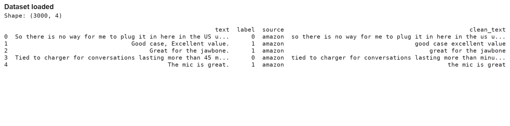
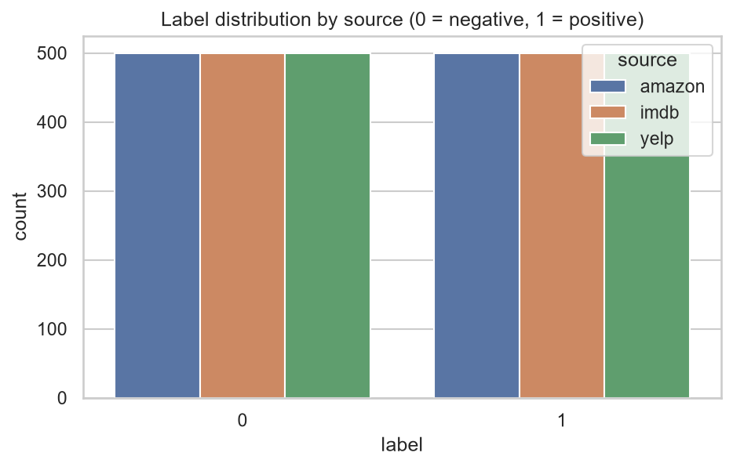
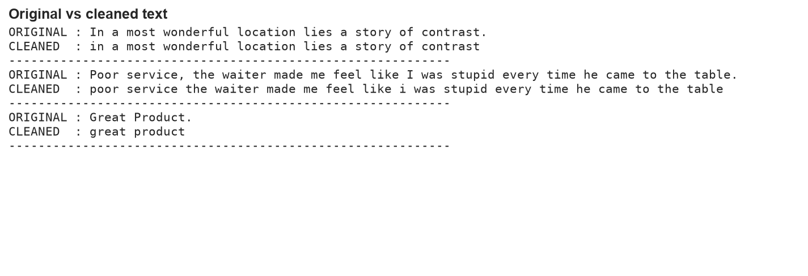
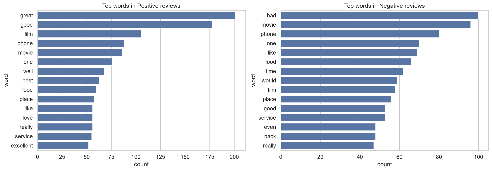
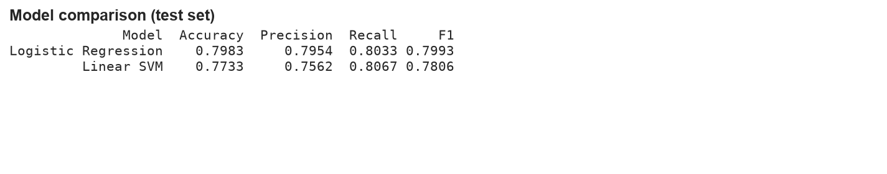
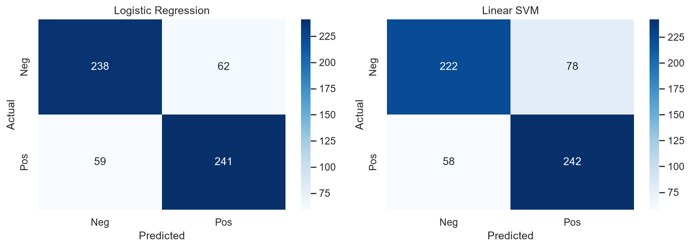
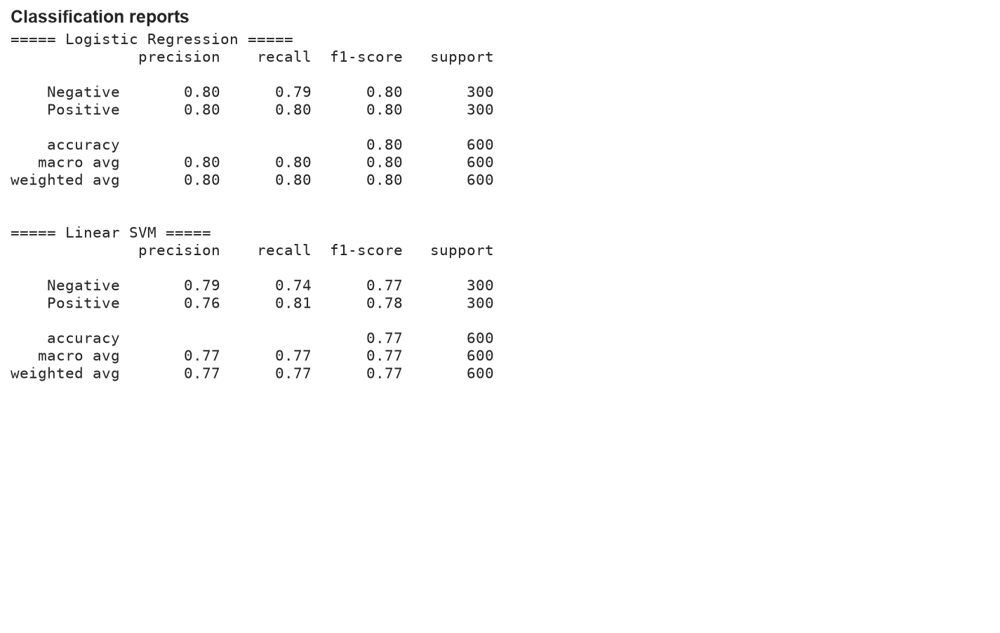
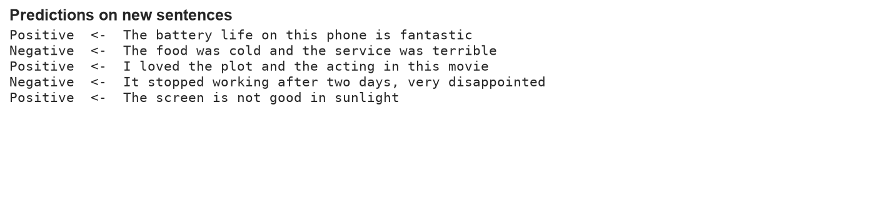
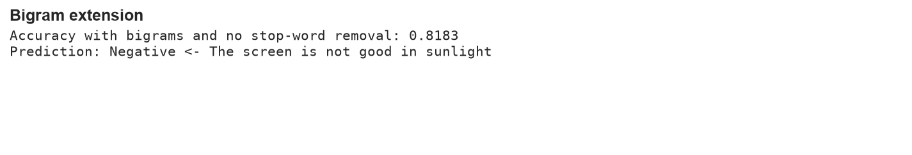

# Lab 01: Sentiment Analysis Using Traditional Machine Learning

## Laboratory Session

**Lab 01: Machine Learning.** Basic NLP with text preprocessing, TF-IDF/Bag-of-Words features and classical machine learning classifiers.

## Objective

To practise a complete classical NLP workflow: load a labelled text dataset, clean and explore it, convert text to numeric features, train sentiment classifiers, evaluate them with standard metrics and test them on unseen sentences. This gives a baseline to compare against the transformer-based models in later labs.

## Tasks and Implementation

- **Notebook:** [`notebook/sentiment_analysis.ipynb`](notebook/sentiment_analysis.ipynb)
- **Data:** [`data/`](data/) (UCI Sentiment Labelled Sentences: Amazon, IMDb and Yelp, 1,000 sentences each, labelled 1 = positive and 0 = negative)
- **Libraries:** Pandas, NumPy, NLTK, scikit-learn, Matplotlib, Seaborn (see [`requirements.txt`](requirements.txt))

| # | Lab task | What was done |
|---|----------|---------------|
| 1 | Download and load the dataset | Loaded the three tab-separated files, added a `source` column and combined them into a single DataFrame of 3,000 sentences |
| 2 | Text preprocessing | Lowercased text, removed punctuation, digits and symbols with regular expressions, collapsed extra whitespace, created a `clean_text` column and compared original and cleaned text |
| 3 | Explore the data | Displayed positive and negative examples, plotted the label distribution and the most frequent words per class (stop words removed) |
| 4 | Split the dataset | 80/20 stratified train/test split (`random_state=42`), giving 2,400 training and 600 test sentences |
| 5 | Bag-of-Words | `CountVectorizer` with English stop words removed and `min_df=2`, fitted on the training set only to avoid data leakage |
| 6 | Train a model | Trained Logistic Regression and a Linear SVM |
| 7 | Evaluate | Accuracy, precision, recall and F1, plus classification reports and confusion matrices |
| 8 | Test with new sentences | Predicted sentiment for five new sentences, including one with negation |
| Extension | Negation handling | Re-trained Logistic Regression keeping all words and adding bigrams, then re-tested |

## Results and Evidence

**Bag-of-Words representation:** vocabulary size of **1,649** words; training matrix shape of 2,400 × 1,649.

**Model comparison on the test set:**

| Model | Accuracy | Precision | Recall | F1 |
|-------|----------|-----------|--------|----|
| Logistic Regression | 0.7983 | 0.7954 | 0.8033 | 0.7993 |
| Linear SVM | 0.7733 | 0.7562 | 0.8067 | 0.7806 |
| Logistic Regression + bigrams, stop words kept | 0.8183 | n/a | n/a | n/a |

**New sentence predictions (baseline Logistic Regression):**

| Sentence | Prediction |
|----------|------------|
| The battery life on this phone is fantastic | Positive |
| The food was cold and the service was terrible | Negative |
| I loved the plot and the acting in this movie | Positive |
| It stopped working after two days, very disappointed | Negative |
| The screen is not good in sunlight | Positive (incorrect) |

After the bigram extension, the last sentence was predicted correctly as **Negative**.

**Evidence images** (generated from the notebook):

| | |
|---|---|
|  |  |
|  |  |
|  |  |
|  |  |
|  | |

## Observations

- **Word frequencies:** Positive reviews are led by words such as "great", "good", "best", "love" and "excellent"; negative reviews are led by "bad", followed mostly by neutral words. Many topic words ("movie", "film", "phone", "food", "service") appear in both classes and carry no sentiment.
- **Negation:** "good" appears among the top negative words. Of the 53 negative reviews containing "good", 35 also contain a negation word (for example, "Not a good bargain"). A few matches are false positives of the simple pattern, so 35 slightly overcounts.
- **Model comparison:** Logistic Regression scored slightly higher than the Linear SVM (accuracy 0.798 vs 0.773). The SVM had a slightly higher recall but clearly lower precision. With a 600-sentence test set, the gap of about 15 sentences may not be significant.
- **Failure case:** The baseline misclassified "The screen is not good in sunlight" as Positive because "not" is on the English stop-word list and was removed before the model saw it.
- **Extension:** Keeping all words and adding bigrams raised accuracy to 0.818 and fixed the failure case. Two changes were made at once, so the experiment does not show which one helped most, and a single split is limited evidence. Testing each change separately and using cross-validation would be a better next step.
- **Challenges:** The VS Code Jupyter kernel picker hung while detecting environments. Restarting the extension host fixed it.

## Learning Outcomes

- Built an end-to-end text classification pipeline with scikit-learn.
- Learned how preprocessing choices, such as stop-word removal, can affect results, and why vectorizers must be fitted on training data only.
- Compared models with several metrics and read confusion matrices instead of relying on accuracy alone.
- Found and tested a model weakness (negation) with a targeted experiment.
- Understood the limits of Bag-of-Words, which ignores word order and context. This motivates the transformer models in later labs.